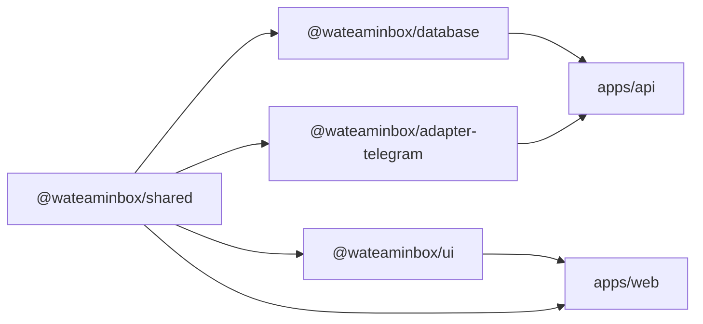
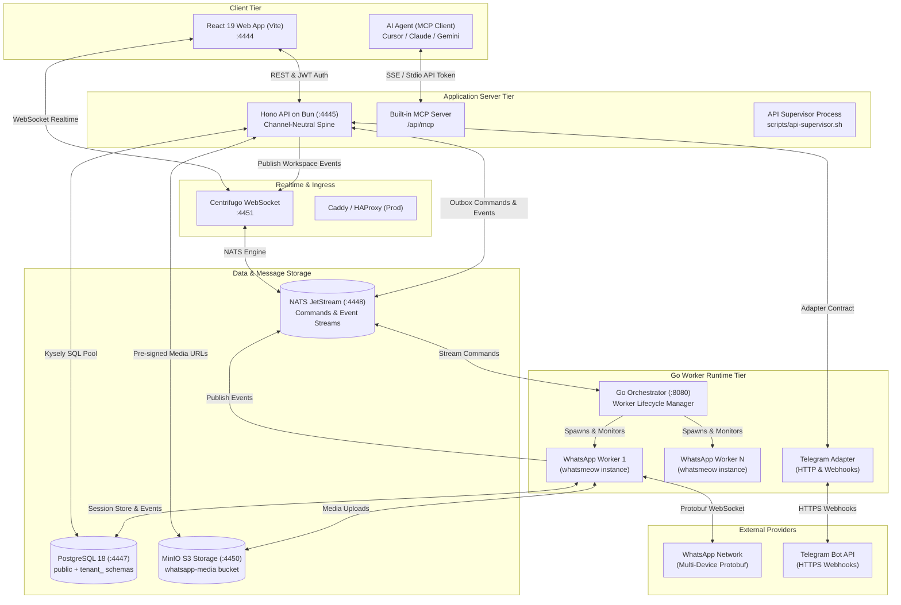
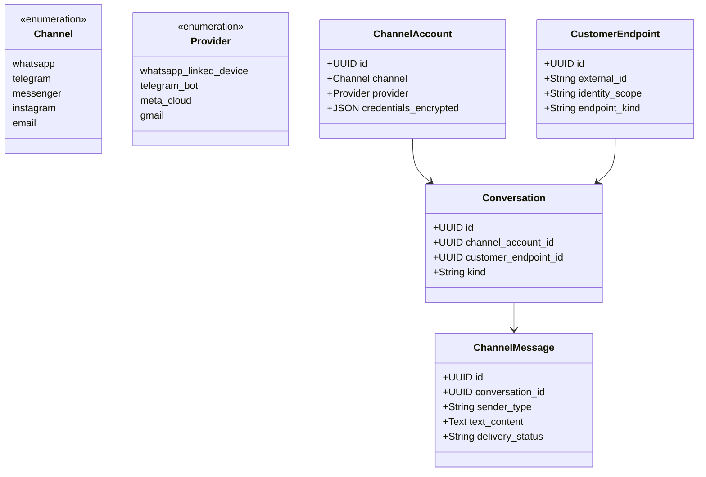
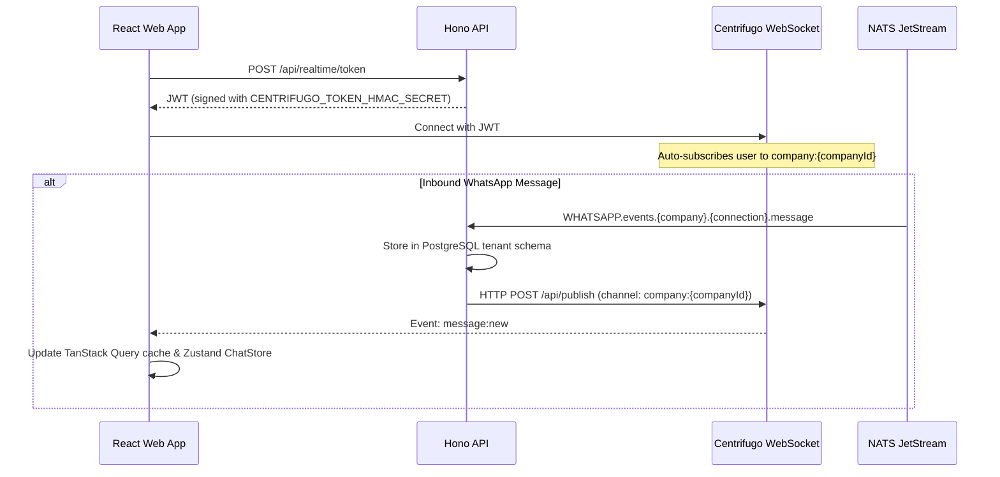

# WATeamInbox: Comprehensive Architectural Memory & Codebase Reference

> **Persistent Architectural Memory Document**  
> *Target Audience: Developers, System Architects, and AI Coding Agents working on WATeamInbox.*  
> *Last Updated: November 2026*

---

## 1. Executive Summary & System Philosophy

**WATeamInbox** is an open-source, multi-tenant, omnichannel collaborative team inbox designed to unify customer messaging across multiple providers into a single, cohesive web platform.

### Core Architecture Highlights
- **Channel-Neutral Messaging Spine**: Completely isolates channel abstractions (e.g. WhatsApp, Telegram, Email) from concrete provider implementations (`whatsapp_linked_device`, `telegram_bot`, `meta_cloud`, etc.). Generic inbox operations (conversations, messages, assignments, labels, notes, audit logs) never depend on provider-specific IDs or protocol nuances.
- **Tenant Isolation**: PostgreSQL 18 dual-schema architecture. Cross-tenant identities and memberships live in the `public` schema; tenant data lives in isolated `tenant_<uuid>` schemas.
- **Durable Event-Driven Architecture**: Powered by **NATS JetStream** for transactional outbox dispatching and worker process communication, and **Centrifugo** for realtime WebSockets to browser clients.
- **Micro-Worker Runtimes**: Go-based worker processes (`whatsmeow`) managed by an intelligent Go orchestrator supervisor (`services/orchestrator`), ensuring connection isolation and auto-recovery.
- **AI-Agent Ready**: Built-in **Model Context Protocol (MCP)** server (`apps/api/src/routes/mcp`) allowing AI assistants (Claude, ChatGPT, Gemini, Cursor) to safely read and act on conversations using scoped API tokens bounded by live RBAC permissions.

---

## 2. Monorepo Structure & Package Dependencies

The repository is structured as a **Turborepo** monorepo managed by **Bun** (`packageManager: bun@1.2.18`).

```text
.
├── apps/
│   ├── api/                     # Hono HTTP API on Bun, channel spine, background dispatchers, MCP server
│   └── web/                     # React 19 + Vite + Tailwind CSS + TanStack Query frontend
├── packages/
│   ├── shared/                  # Shared TypeScript types, contracts, phone/JID utils, date helpers
│   ├── database/                # Kysely database client, 110 schema migrations, schema contract checks
│   ├── adapter-telegram/        # Telegram Bot API normalization, capabilities & HTTP transport
│   └── ui/                      # Shared UI component primitives (Button, Dropdown, Dialog, etc.)
├── services/
│   ├── orchestrator/            # Go process manager supervising WhatsApp linked-device worker processes
│   ├── whatsapp/                # Go worker utilizing whatsmeow library for linked-device WhatsApp
│   └── shared/                  # Shared Go NATS subjects, event types, JetStream stream configurations
├── infrastructure/              # Docker, Centrifugo, NATS, Caddy, HAProxy configurations
├── docs/                        # Specifications, RFCs, and API documentation
└── scripts/                     # Dev startup, database migration, supervisor, and test utilities
```

### Critical Package Build Order
Workspace packages output compiled artifacts into their respective `dist/` directories via `tsup`. To prevent missing module errors, they **must** be compiled in the following sequence:



1. `packages/shared`: `bun run build`
2. `packages/database`: `bun run build`
3. `packages/adapter-telegram`: `bun run build`
4. `packages/ui`: `bun run build`
5. Go binaries:
   - `services/whatsapp`: `go build -o whatsapp-worker main.go` *(macOS requires `codesign --force --sign - whatsapp-worker`)*
   - `services/orchestrator`: `go build -o tmp/orchestrator main.go`

---

## 3. High-Level System Architecture Diagram



---

## 4. Multi-Tenancy & Data Architecture

WATeamInbox employs a **multi-schema tenancy model** within a single PostgreSQL database instance.

### 4.1 The `public` Schema (Global Data)
Contains cross-tenant metadata, user accounts, and authentication sessions:
- `users`: Core user accounts (email, password hash, verification timestamp, profile).
- `companies`: Workspaces/Tenants (id, name, `schema_name`, status, max connections).
- `company_members`: Associates users with companies, assigning roles (`owner`, `admin`, `member`, `agent`) and JSON permissions.
- `user_sessions`: Active user sessions storing SHA-256 hashed refresh tokens and expiry.
- `auth_tokens`: One-time expiring tokens for email verification and password resets.
- `api_tokens`: Scoped API tokens for third-party integrations and AI Agent MCP access.
- `oauth_*`: OAuth authorization codes, clients, and grants.
- `channel_spine_workspace_flags`: Per-workspace feature flags controlling channel spine cutover (reads, dual-write, write authority).
- `api_rate_limit_buckets`: Distributed rate-limiting sliding windows.

### 4.2 The `tenant_<uuid>` Schemas (Tenant-Isolated Data)
Each company has its own isolated schema named `tenant_<company_id>` (with hyphens replaced by underscores). The runtime schema contract is enforced by `packages/database/src/tenant-schema.ts`:

| Table Name | Purpose |
| :--- | :--- |
| `whatsapp_connections` | WhatsApp linked-device accounts (JID, phone, sync status, QR code state). |
| `channel_accounts` | Channel-neutral account definitions (`channel`, `provider`, credentials). |
| `channel_customer_endpoints`| Customer communication endpoints (e.g. phone numbers, Telegram chat IDs). |
| `conversations` | Normalized conversation threads linking endpoints to channel accounts. |
| `channel_messages` | Normalized messages across all providers. |
| `channel_attachments` | Message attachments with MinIO storage URIs, mime types, and byte sizes. |
| `channel_message_action_intents` | Idempotent outbound action dispatch queue for neutral providers. |
| `contacts` | Unified customer CRM profiles (name, phone, username, avatar, custom fields). |
| `messages` | Legacy / compatibility table for WhatsApp messages. |
| `quick_replies` | Team canned responses with shortcut keys and category tags. |
| `tags` / `whatsapp_labels` | Organizing tags and native WhatsApp conversation labels. |
| `notes` | Internal team collaboration notes attached to conversations. |
| `conversation_states` | Workflow resolution states (open, pending, resolved, snoozed). |
| `conversation_cases` | SLA and case management tracking resolution metrics. |
| `notifications` | In-app alerts, mentions, and assignment notifications. |
| `audit_logs` | Tamper-evident log of member actions, exports, and permission changes. |
| `group_members` | Participants in group conversations with LID/JID resolution. |
| `scheduled_messages` | Future-scheduled automated message dispatches. |
| `bulk_jobs` | Mass broadcast jobs with pacing, rate-limiting, and delivery tracking. |

### 4.3 Database Access Pattern
The API constructs tenant queries using Kysely:
```typescript
// apps/api/src/services/tenant.service.ts
const tenantDb = createTenantDb(companyId);
const conversations = await tenantDb
  .selectFrom("conversations")
  .where("channel_account_id", "=", accountId)
  .selectAll()
  .execute();
```
All queries are parameterized, preventing cross-tenant leakage.

---

## 5. Channel-Neutral Spine Architecture

The spine cleanly decouples channel concepts:



### Event Ingress & Egress Lifecycle
1. **Ingress**:
   - **WhatsApp**: whatsmeow worker emits events (`SubjectMessage`, `SubjectReaction`) to NATS JetStream `WHATSAPP_EVENTS`. API NATS lifecycle consumers process and commit them into tenant tables.
   - **Telegram**: Webhook reaches `/api/channels/telegram/webhook/:accountId`. The webhook secret is verified, payload normalized via `packages/adapter-telegram`, and committed to `channel_messages`.
2. **Egress (Sending Messages)**:
   - Client sends `POST /api/conversations/:id/messages`.
   - API verifies `can_send_messages` permission.
   - For WhatsApp linked device: Committed to transactional `message_delivery_outbox` -> published to NATS `WHATSAPP_COMMANDS` -> Go worker picks up -> sends via whatsmeow -> emits `send_confirmation`.
   - For neutral providers (Telegram): Inserted into `channel_message_action_intents` -> leased by outbound dispatcher -> HTTP call to Telegram Bot API.

---

## 6. Realtime Event Fabric & Centrifugo

The web frontend maintains a single WebSocket connection to **Centrifugo** (`ws://localhost:4451/connection/websocket`).



### Channel Policy
- **Workspace-wide channel (`company:{companyId}`)**: Transmits broad notifications: connection state changes (`connected`, `disconnected`, `qr`), bulk job progress, and toast alerts.
- **Contact/Conversation-scoped events**: To respect contact assignment visibility, conversation messages and typing indicators are dispatched only to members authorized to see that contact.

---

## 7. Go Worker & Orchestrator Subsystem

### `services/orchestrator`
- Supervises WhatsApp worker processes on local and production hosts.
- Listens to NATS commands on `WHATSAPP.commands` and node-specific subjects (`WHATSAPP.commands.node.<id>`).
- Enforces single active worker per WhatsApp connection using node-fencing locks.
- Provides health probe HTTP server (`:8080/health`).
- **Development vs. Production**:
  - *Linux Production*: Uses durable worker registry, Linux cgroup/uid separation for process isolation.
  - *macOS Local Dev*: Operates in persistence-free manager mode while worker processes use restricted DB/NATS credentials.

### `services/whatsapp`
- Standalone Go binary compiled against `go.mau.fi/whatsmeow`.
- Interacts with WhatsApp's multi-device noise protocol.
- Directly stores cryptographic session state and device keys in PostgreSQL.
- Streams media files to MinIO/S3 and returns pre-signed access URLs.
- Handles history synchronization, contact backfill, and group LID (Linked Identity Device) resolution.

---

## 8. Authentication, Authorization & Security

### 8.1 Token Flow
- **Access Token**: Short-lived JWT (15m expiration) stored only in frontend memory. Signed with `JWT_SECRET`.
- **Refresh Token**: Long-lived JWT (7d expiration) stored in HttpOnly, SameSite `wateaminbox_refresh` cookie.
- **Session Hash**: On login, a SHA-256 hash of the refresh token is stored in `public.user_sessions`. Rotation allows a configurable grace period (`JWT_REFRESH_REUSE_GRACE_SECONDS=60`) to avoid race conditions.

### 8.2 Role-Based Access Control (RBAC)
- Roles: `owner` > `admin` > `member` > `agent`.
- Granular permissions: `can_view_all_conversations`, `can_send_messages`, `can_manage_team`, `can_manage_connections`, `can_export_data`, etc.
- Unassigned conversation filtering ensures agents only see conversations assigned directly to them unless granted global view permission.

### 8.3 AI Agent MCP Server
- Mount point: `POST /api/mcp` and `GET /api/mcp/sse`.
- Authenticates using Bearer API Tokens generated in Settings → API Tokens.
- Provides tools:
  - `read`: List conversations, search messages, retrieve contact metadata.
  - `write`: Send messages, assign contacts, update notes, set tags.
  - `settings`: View connection status and workspace configuration.
  - `scheduling`: Schedule future customer outreach.

---

## 9. Frontend Architecture (React 19 + Vite)

### State Management
- **TanStack Query (React Query)**: Handles server cache, optimistic updates, and infinite scrolling pagination for messages (`useInfiniteMessages`).
- **Zustand**: Manages ephemeral UI state via modular slices (`apps/web/src/stores/chat`):
  - `conversation-slice`: Active conversation selection.
  - `drafts-slice`: Unsent draft messages per chat.
  - `typing-slice`: Realtime typing indicator tracking.
  - `selection-slice`: Bulk message selection.
- **Context Providers**: `AuthProvider`, `WorkspaceProvider`, `RealtimeProvider`, `NotificationProvider`.

### Component System
- Built on top of Radix UI primitives with Tailwind CSS.
- Shared dropdown invariant: All single-choice dropdowns must use `@/components/ui/select` (enforced by `select-policy.test.ts`).
- Mobile-first responsive layout with native keyboard inset detection.

---

## 10. Operational Runbook & Developer Reference

### Common CLI Tasks

| Task | Command |
| :--- | :--- |
| **Start full stack (dev)** | `./dev-start.sh` (or `bun run dev` after infra is up) |
| **Run migrations** | `bun run db:migrate` |
| **Inspect API logs** | `tail -f logs/api.log` |
| **Inspect worker logs** | `tail -f logs/whatsapp-worker.log` |
| **Inspect orchestrator**| `tail -f logs/orchestrator.log` |
| **Run unit & lint tests** | `bun test` and `bun run lint` |
| **Run type check** | `bun run typecheck` |
| **Clean Docker volumes** | `./scripts/clean-db.sh` and `./scripts/clean-nats.sh` |

### Known Gotchas & Troubleshooting
1. **`Cannot find module @wateaminbox/adapter-telegram`**:
   - Cause: `packages/adapter-telegram` has not been compiled to `dist/`.
   - Fix: `(cd packages/adapter-telegram && bun run build)`.
2. **macOS "Signal: killed" on WhatsApp Worker**:
   - Cause: macOS Gatekeeper ad-hoc code-signing invalidation.
   - Fix: `codesign --force --sign - services/whatsapp/whatsapp-worker`.
3. **Local Emails Not Delivering**:
   - Explanation: Local development defaults to `MAIL_DRIVER=log`. All verification and reset links are printed to `logs/api.log`.
4. **Rate Limit 429 Errors**:
   - Development rate limiter permits generous thresholds, but rapid test loops may fill `api_rate_limit_buckets`. Clear with:
     `docker exec wateaminbox-postgres psql -U postgres -d wateaminbox -c "TRUNCATE api_rate_limit_buckets;"`

